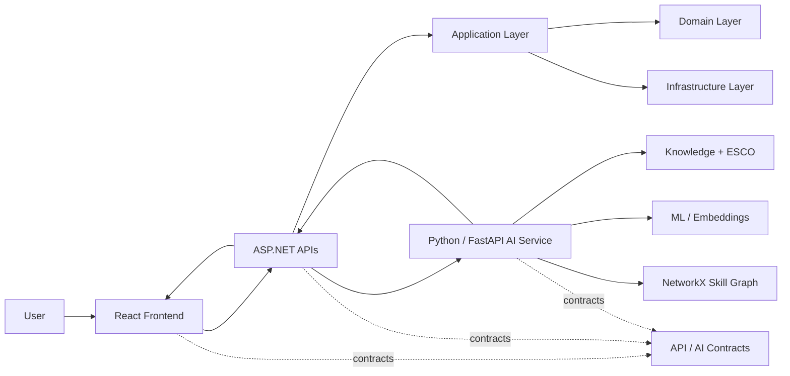

# PathGraph — Architecture & Team Guide

> **Graduation Project · Hadhramout University · Computer Science**
> A modular, AI-assisted learning-path engine that models skills and prerequisites as a graph, analyses learner gaps, and generates structured learning paths.

### Tech Stack

<p>
  
  
  
  
</p>

<p>
  
  
  
  
  
  
</p>

| Layer | Technology |
|---|---|
| **Frontend** | React + TypeScript |
| **Backend** | **ASP.NET APIs** (.NET 10) |
| **AI Service** | Python + FastAPI |
| **Database** | PostgreSQL |
| **Graph Engine** | NetworkX |
| **Knowledge** | ESCO Taxonomy |
| **Contracts** | OpenAPI + TypeScript types |

---

## 1. Architecture at a Glance



### Architectural principle

**The backend orchestrates the application; the AI service performs intelligent analysis; the graph represents structured skill relationships; the frontend presents the resulting paths.**

| Layer | Responsibility | Primary technology |
|---|---|---|
| **Frontend** | User experience, visualisation, interaction | React + TypeScript |
| **Backend** | Application orchestration, business rules, API | ASP.NET APIs / .NET 10 |
| **AI** | Skill extraction, embeddings, gap analysis, recommendations | Python + FastAPI |
| **Graph** | Skill/prerequisite representation and path structure | NetworkX |
| **Knowledge** | Taxonomy, schemas, seed knowledge and domain data | ESCO + project knowledge |
| **Contracts** | Stable communication boundaries between components | OpenAPI + TypeScript types |

---

## 2. Repository Structure

```text
PathGraph/
│
├── frontend/       # Web application and user experience
├── backend/        # Core application API and business logic
├── ai/             # AI/ML pipeline and inference service
├── contracts/      # API contracts shared across components
├── knowledge/      # Versioned domain knowledge and graph seeds
├── docs/           # Architecture, AI and development documentation
├── infra/          # Deployment and reverse-proxy configuration
├── tests/          # End-to-end validation
│
├── .github/        # CI/CD, repository governance and ownership
├── compose.yaml    # Local multi-service orchestration
├── Makefile        # Common development commands
├── CONTRIBUTING.md # Contribution workflow and conventions
└── LICENSE
```

---

## 3. Main Folder Objectives

### `frontend/` — Presentation Layer
Owns everything visible and interactive.

- React application structure
- Authentication and navigation
- Career and skill views
- Learning-path visualisation
- Recommendations and learner-facing workflows
- API consumption
- Shared UI components

**Boundary:** no core business logic and no direct database access.

---

### `backend/` — Application Core
Provides the principal HTTP API and coordinates application behaviour.

```text
backend/
├── src/
│   ├── PathGraph.Api/
│   ├── PathGraph.Application/
│   ├── PathGraph.Domain/
│   └── PathGraph.Infrastructure/
└── tests/
```

| Project | Objective |
|---|---|
| `PathGraph.Api` | HTTP endpoints, authentication, dependency injection and API composition |
| `PathGraph.Application` | Use cases, application services and orchestration |
| `PathGraph.Domain` | Core entities, value objects and domain rules |
| `PathGraph.Infrastructure` | Persistence, external services and technical implementations |
| `backend/tests/` | Unit, integration and architectural tests |

**Dependency direction:**
`Api → Application → Domain`
`Api → Infrastructure → Application/Domain`

The Domain layer remains independent of infrastructure concerns.

---

### `ai/` — AI & Machine Learning
Contains the data-to-intelligence pipeline and the Python service.

```text
ai/
├── data/
│   ├── raw/         # Immutable source datasets
│   ├── interim/     # Intermediate transformations
│   └── processed/   # Model-ready data
├── models/          # Trained / exported model artefacts
├── notebooks/       # Exploratory research and experiments
├── src/             # Production AI implementation
└── tests/           # AI unit and integration tests
```

Core responsibilities:

1. Prepare and validate ESCO and project data.
2. Represent occupations and skills.
3. Generate embeddings and graph features.
4. Analyse learner skill gaps.
5. Generate and rank candidate learning paths.
6. Expose inference capabilities through FastAPI.

**Principle:** experimentation belongs in notebooks; reproducible production logic belongs in `src/`.

---

### `contracts/` — Integration Boundary
Defines the formal interfaces between the frontend, backend and AI service.

- API specifications
- AI service specification
- Shared TypeScript types
- Request/response fixtures
- Contract-drift validation

**Rule:** change the contract deliberately; update every affected consumer.

---

### `knowledge/` — Domain Knowledge
Stores structured knowledge required to construct and maintain PathGraph's knowledge layer.

| Folder | Objective |
|---|---|
| `taxonomy/` | Skill and occupation taxonomy sources |
| `schema/` | Knowledge representation schemas |
| `seeds/` | Curated initial graph knowledge |

ESCO is the principal external taxonomy source; its provenance and licence requirements must be preserved in project documentation.

---

### `docs/` — Project Knowledge
The canonical location for decisions and technical documentation.

```text
docs/
├── adr/           # Architecture Decision Records
├── architecture/  # System and component architecture
├── ai/            # AI methodology and experiments
└── development/   # Development procedures and conventions
```

**Rule:** significant architectural decisions belong in `docs/adr/`, not only in chat or commit messages.

---

### `infra/` — Deployment Infrastructure
Contains operational configuration that is independent of application code.

- Reverse proxy configuration
- Deployment manifests
- Environment-specific infrastructure

---

### `tests/` — Cross-Component Validation
Contains tests that validate the integrated product rather than an individual component.

- End-to-end workflows
- Cross-service behaviour
- Critical user journeys

Component-specific tests remain inside their owning area.

---

### `.github/` — Engineering Governance

- GitHub Actions CI/CD
- `CODEOWNERS`
- Pull-request templates
- Issue templates
- Dependency automation

This directory enforces the repository's collaboration and quality gates.

---

## 4. Team Responsibilities

Ownership is **area-based**: contributors may collaborate across boundaries, but each area has an accountable owner.

| Team | Primary ownership | Core duties |
|---|---|---|
| **Frontend** | `frontend/` | UI, UX, React features, visualisations, frontend integration |
| **Backend** | `backend/src/` | API, application logic, domain model, service orchestration |
| **Database** | `backend/src/PathGraph.Infrastructure/` | Schema, persistence, migrations, query efficiency and data integrity |
| **AI** | `ai/` | AI pipeline, embeddings, inference service and model integration |
| **ML / Graph** | `ai/` + `knowledge/` | graph construction, NetworkX algorithms, skill-gap analysis, path generation and evaluation |
| **Web / Integration** | `contracts/` + cross-component integration | API contracts, integration flows, E2E coordination and interface consistency |
| **Project / Architecture** | `docs/` + repository governance | architectural decisions, documentation, milestones and engineering standards |

### Ownership rule

> **Own the implementation, not the entire product.**
> A team is responsible for the integrity of its area and for maintaining a clean interface with neighbouring areas.

---

## 5. Development Flow

```text
Issue
  ↓
Branch
  ↓
Implementation
  ↓
Local Tests
  ↓
Pull Request
  ↓
CI Checks
  ├── Frontend
  ├── Backend
  ├── AI
  ├── Contract validation
  └── E2E
  ↓
Review
  ↓
Merge
```

### Pull-request expectations

- One coherent change per PR.
- Tests accompany behavioural changes.
- Contracts are updated with interface changes.
- Architectural changes require documentation.
- `CODEOWNERS` determines the relevant reviewers.
- CI must pass before merging.

---

## 6. AI Pipeline

```text
ESCO / Source Data
       ↓
Data Cleaning & Preparation
       ↓
Skill / Occupation Representation
       ↓
Embeddings + Graph Construction
       ↓
Learner Profile
       ↓
Skill-Gap Analysis
       ↓
Candidate Path Generation
       ↓
Path Ranking / Validation
       ↓
Learning Path
       ↓
Backend API
       ↓
React UI
```

The intended design separates **probabilistic intelligence** from **deterministic structure**:

- ML models estimate similarity, relevance or learner-related signals.
- The skill graph supplies explicit prerequisites and relationships.
- The path-generation layer combines both to produce a coherent route.
- Evaluation measures whether generated paths satisfy the defined constraints.

---

## 7. Non-Negotiable Boundaries

| Rule | Reason |
|---|---|
| Frontend does not access the database directly | Preserve architectural separation |
| AI does not become the application's business layer | Keep ML independently testable and replaceable |
| Domain does not depend on Infrastructure | Preserve dependency inversion |
| Shared interfaces live in `contracts/` | Prevent undocumented coupling |
| Raw datasets remain immutable | Preserve reproducibility |
| Experiments do not become production code automatically | Prevent research code from contaminating services |
| Architecture decisions are documented | Preserve institutional knowledge |

---

## 8. Repository Ownership Map

```text
frontend/   → Frontend Team
backend/    → Backend + Database Teams
ai/         → AI + ML/Graph Teams
contracts/  → Web/Integration Team
knowledge/  → ML/Graph Team
docs/       → Project/Architecture
infra/      → Web/Integration + CI/CD
tests/      → Each owning team + Integration
.github/    → Repository maintainers
```

---

## 9. Working Principle

**PathGraph is one product, one repository, and multiple bounded areas of responsibility.**

The repository structure exists to make those boundaries explicit, minimise accidental coupling, and allow the team to develop frontend, backend, AI, graph, data, and infrastructure components concurrently without losing architectural coherence.